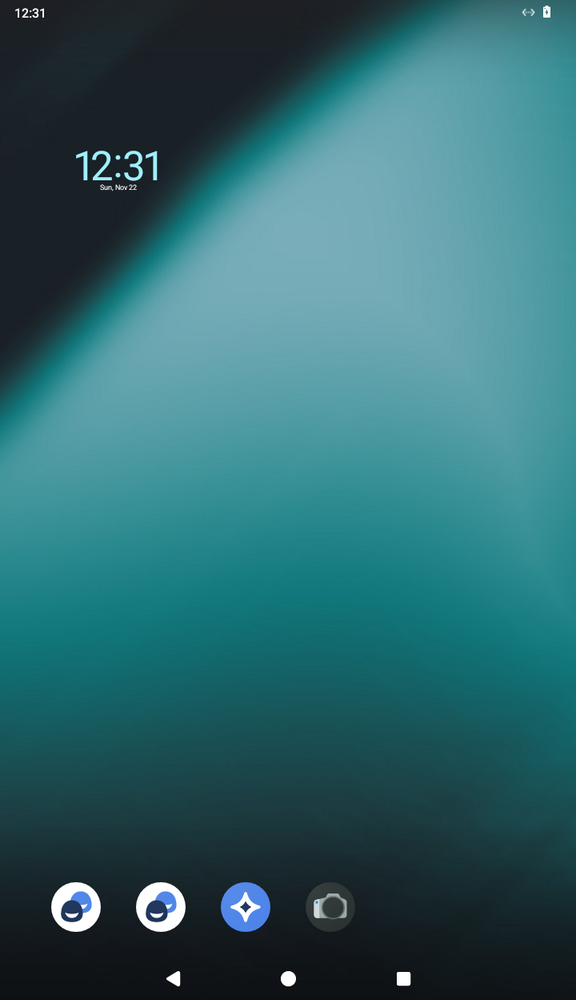
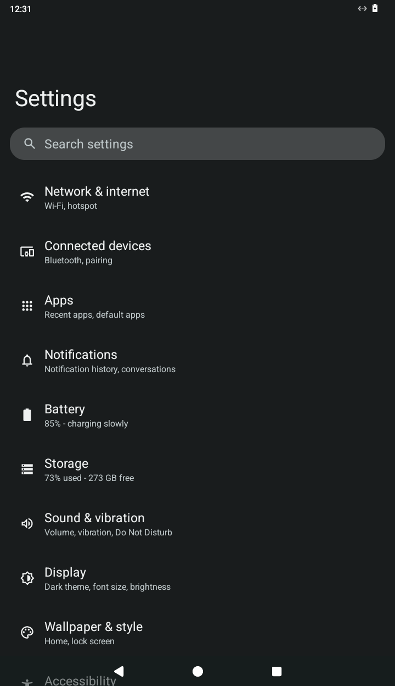
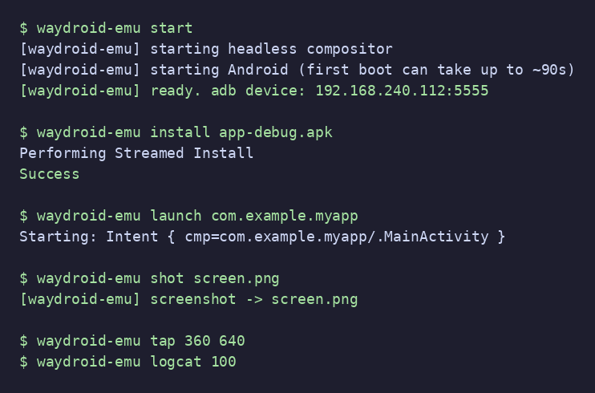

# Waydroid on Linux — Run Android Apps Without the Emulator Tax

**Android in a container, windowed on X11, with a headless ADB-driven emulator for agents and CI.**

Built and battle-tested on modest hardware (Intel i5-4300U, 2 cores, 11 GB RAM,
5400 rpm HDD) where the Android Studio emulator is painful. Waydroid runs
Android directly on the host kernel via LXC + binder — no CPU virtualization
overhead — so it's dramatically lighter than a full VM.

---

## Screenshots

**Android home screen, running on Linux:**



**A real app (Settings) running:**



**Driving it from the terminal with the headless emulator:**



---

## Table of Contents

1. [Why this exists](#why-this-exists)
2. [Features](#features)
3. [Requirements](#requirements) (incl. [distro support](#distro-support))
4. [Installation](#installation) (Debian / Fedora / Arch)
5. [Usage](#usage)
6. [How it works (technical deep-dive)](#how-it-works-technical-deep-dive)
7. [Agent / CI automation](#agent--ci-automation)
8. [Performance tuning](#performance-tuning)
9. [Troubleshooting](#troubleshooting)
10. [Known limitations](#known-limitations)
11. [Uninstall](#uninstall)
12. [Credits & License](#credits--license)

---

## Why this exists

Android Studio's emulator is a **full Android VM**. On a dual-core CPU with an
HDD and limited RAM, it thrashes swap, takes minutes to boot, and makes the
machine unusable while it runs.

**Waydroid** runs Android inside an **LXC container** using the host kernel and
the `binder` IPC driver. There's no guest kernel, no CPU virtualization, and no
emulator tax — apps launch like native Linux processes.

The catch: **Waydroid is a Wayland application.** Most Linux desktops (Cinnamon,
Xfce, MATE, KDE on X11) don't run a Wayland compositor, so `waydroid session
start` fails with:

```
Wayland socket '.../wayland-0' doesn't exist; are you running a Wayland compositor?
```

These scripts solve that by running a **nested Wayland compositor (weston) on top
of X11**, so Android gets a Wayland display to render into — and you get Android
apps in a window on your normal desktop.

---

## Features

### `waydroid-ui` — windowed Android on X11
- Starts (or reuses) a nested `weston` compositor on the X11 backend.
- Boots the Waydroid session and waits until Android is **actually** ready.
- Automatically restarts a headless session so the UI becomes visible.
- Cleans everything up (session + compositor) when you close the window.
- Single-instance lock so you don't accidentally launch two.

### `waydroid-emu` — headless Android + ADB for automation
- Boots Android with **no window** (headless weston) — ideal for servers/CI.
- Exposes **ADB over the network** (`adb connect <ip>:5555`).
- Commands: `install`, `launch`, `shot` (screenshots), `tap`, `swipe`, `text`,
  `key`, `logcat`, `shell`, `packages`, `status`, `stop`.
- **Keep-warm**: a warm start is **<1 second** (vs ~60s cold).

### `waydroid-tune` — optional CPU governor tuning
- Pins the CPU to `performance` mode for faster cold boots (then restore with
  `schedutil`).

---

## Requirements

| Component | Purpose | Install (Debian/Ubuntu/Mint) |
|-----------|---------|------------------------------|
| **Waydroid** | Android container runtime | `sudo apt install waydroid` |
| **weston** | Wayland compositor (nested on X11) | `sudo apt install weston` |
| **adb** | For `waydroid-emu` automation | `sudo apt install adb` |
| **binder_linux** | Kernel module (usually auto-loaded) | `sudo modprobe binder_linux` |

Also:
- A GPU with Mesa (Intel/AMD/NVIDIA) — Waydroid uses it for rendering.
- `waydroid-container` systemd service enabled.
- `waydroid init` must have been run at least once (downloads the Android image).

### Distro support

`install.sh` auto-detects your distro and prints the correct install commands.
The scripts themselves are plain bash + standard tools, so they run anywhere
Waydroid does.

| Distro family | Examples | Support |
|---------------|----------|---------|
| **Debian / Ubuntu** | Ubuntu, Linux Mint, Pop!_OS, elementary, Zorin, KDE neon, Debian | ✅ Full (Waydroid's primary target) |
| **Arch** | Arch, EndeavourOS, Manjaro, Garuda | ✅ Full (AUR: `waydroid`, `waydroid-image`) |
| **Fedora / RHEL** | Fedora, Rocky, Alma | ⚠️ Works with COPR repo + SELinux note (see below) |
| **openSUSE** | openSUSE Leap/Tumbleweed | ⚠️ Community repo |
| **NixOS / Gentoo / Void** | — | ⚠️ Manual (no official package) |
| **Alpine** | Alpine | ❌ musl libc — Waydroid is glibc-only |

**Fedora** needs the COPR repo and possibly an SELinux policy:
```bash
sudo dnf copr enable waydroid/stable
sudo dnf install waydroid weston android-tools
# if SELinux blocks it:
sudo ausearch -c 'waydroid' --raw | audit2allow -M waydroid
sudo semodule -i waydroid.pp
```

**Arch** (AUR):
```bash
yay -S waydroid waydroid-image weston android-tools
```

> **Note:** These scripts assume Waydroid is already installed and initialized.
> For a full from-scratch setup, follow the [official Waydroid install guide](https://docs.waydro.id/usage/install-on-desktops)
> first, then run `./install.sh` from this repo.

Check your system (detects distro + verifies prerequisites):
```bash
./install.sh --check
./install.sh --distro   # just show detected distro
```

---

## Installation

### 1. Install Waydroid (if you haven't)

**Debian / Ubuntu / Linux Mint:**
```bash
sudo apt install waydroid
sudo waydroid init
sudo systemctl enable --now waydroid-container
```

**Fedora / RHEL:**
```bash
sudo dnf copr enable waydroid/stable
sudo dnf install waydroid weston android-tools
sudo waydroid init
sudo systemctl enable --now waydroid-container
# if SELinux blocks Waydroid:
sudo ausearch -c 'waydroid' --raw | audit2allow -M waydroid
sudo semodule -i waydroid.pp
```

**Arch / EndeavourOS / Manjaro:**
```bash
yay -S waydroid waydroid-image weston android-tools
sudo waydroid init
sudo systemctl enable --now waydroid-container
```

If your kernel doesn't auto-load binder:
```bash
sudo modprobe binder_linux
echo binder_linux | sudo tee /etc/modules-load.d/binder.conf
```

### 2. Install this repo's scripts

```bash
git clone https://github.com/Emerald-dev0/waydroid-linux.git
cd waydroid-linux
./install.sh
```

This copies the three scripts to `~/.local/bin` and installs a **Waydroid**
desktop entry. Verify:
```bash
./install.sh --check
```

### 3. Launch

- **Menu:** open **Waydroid** from your application menu.
- **Terminal:** `waydroid-ui` (windowed) or `waydroid-emu start` (headless).

---

## Usage

### Windowed (normal app use)

```bash
waydroid-ui
```

Or click **Waydroid** in your app menu. The first boot takes ~60s; after that,
re-launching is instant (the session stays warm).

### Headless emulator (for agents / CI)

```bash
waydroid-emu start          # boot headless + connect adb
waydroid-emu status         # session + adb state
waydroid-emu install app.apk
waydroid-emu launch com.example.app
waydroid-emu shot out.png   # screenshot (720x1248 PNG)
waydroid-emu tap 360 640
waydroid-emu text "hello"
waydroid-emu key KEYCODE_BACK
waydroid-emu logcat 300
waydroid-emu shell "getprop ro.product.model"
waydroid-emu stop
```

While it's running, plain ADB works too:
```bash
adb connect $(waydroid-emu ip)
adb -s 192.168.240.112:5555 exec-out screencap -p > shot.png
```

### Optional: faster cold boot

```bash
sudo waydroid-tune performance   # pin CPU governor
sudo waydroid-tune schedutil     # restore default
```

---

## How it works (technical deep-dive)

### 1. Wayland on X11
Waydroid needs a Wayland display. `waydroid-ui` starts:
```bash
weston --backend=x11-backend.so --socket=wayland-0
```
and points `WAYLAND_DISPLAY` at it. Android renders into a window on your X11
desktop. No logout, no Wayland session required.

### 2. Binder
Waydroid's root service loads the binder driver and creates the device nodes:
```bash
modprobe binder_linux devices="anbox-binder,anbox-vndbinder,anbox-hwbinder"
mount -t binder binder /dev/binderfs
# then symlinks /dev/binderfs/* -> /dev/
```

### 3. Readiness detection
`waydroid status` flips to `Session: RUNNING` as soon as the LXC container
starts — long before Android is usable. The scripts instead poll the session log
for the line `Android with user 0 is ready` before showing the UI.

### 4. No freeze
With no UI activity, Android suspends and Waydroid freezes the container
(D-Bus `ContainerManager.Freeze`), which hangs ADB. The emulator keeps the
screen on:
```bash
adb shell svc power stayon true
adb shell settings put system screen_off_timeout 2147483647
```
and calls the D-Bus `Unfreeze` method defensively before any ADB command.

### 5. Networking
`waydroid-net.sh` creates a NAT bridge (`waydroid0`, `192.168.240.1/24`) with
dnsmasq for DHCP/DNS. The container gets `192.168.240.112`, and all its traffic
is MASQUERADE'd through your PC's connection. This is why Android uses your
PC's internet — there's no other route.

### 6. ADB
The container runs `adbd` on port `5555`, reachable at `192.168.240.112:5555`.
`waydroid-emu` reads the IP from the dnsmasq lease file and connects.

---

## Agent / CI automation

`waydroid-emu` is designed so an AI agent or CI pipeline can use Android as a
test target:

```bash
# Boot once, then iterate fast
waydroid-emu start

# Build → install → launch → verify loop
./gradlew assembleDebug
waydroid-emu install app/build/outputs/apk/debug/app-debug.apk
waydroid-emu launch com.example.myapp
waydroid-emu shot /tmp/screen.png   # agent reads the PNG
waydroid-emu tap 360 640            # interact
waydroid-emu logcat 200             # debug

# Clean up
waydroid-emu stop
```

Because the emulator is headless and ADB-based, it works over SSH, in Docker, or
in any CI runner with a Wayland-capable GPU.

---

## Performance tuning

- **Keep-warm is king.** A warm `waydroid-emu start` is <1s; a cold boot is
  ~60s on HDD + dual-core CPUs. Leave the emulator running between test runs.
- **CPU governor:** `sudo waydroid-tune performance` pins the CPU for faster
  cold boots (modest gain; restore with `schedutil`).
- **Disk:** cold boot is disk-I/O bound (~2.4 GB of images read). An SSD helps a
  lot. A tmpfs for the images is possible but risky on low-RAM machines.

---

## Troubleshooting

### "Wayland socket doesn't exist"
You're on X11 with no Wayland compositor. Use `waydroid-ui` (it starts one), or
start a Wayland session.

### ADB can't connect / "No route to host"
The container's network is in a bad state (common after a crash). Restart:
```bash
waydroid-emu stop && waydroid-emu start
```

### Camera doesn't work
See [Known limitations](#known-limitations).

### `binder_linux` not found
```bash
sudo modprobe binder_linux
echo binder_linux | sudo tee /etc/modules-load.d/binder.conf
```

### Session freezes and ADB hangs
The container froze. Wake it:
```bash
waydroid-emu connect   # calls D-Bus Unfreeze, then reconnects
```

### First boot is very slow
Normal on HDD + weak CPUs (~60s). Subsequent warm starts are <1s.

---

## Known limitations

### Camera / video capture
On many setups the camera **streams** correctly (v4l2 HAL, e.g. 1280x720@30fps)
but **SurfaceFlinger crashes** when it tries to render the camera's YV12 buffer:
```
RenderEngine: Failed to create a valid texture [1280,720] format:YV12
```
This is a Waydroid `minigbm` gralloc limitation — the YV12 buffers it allocates
aren't GPU-importable. It affects **all** camera apps and video playback.

**Workarounds:**
1. Try the legacy GL renderer (the crash is in Skia):
   ```bash
   echo "debug.renderengine.renderengine=gl" | sudo tee -a /var/lib/waydroid/waydroid_base.prop
   waydroid-emu stop && waydroid-emu start
   ```
2. Use a Waydroid image with a different gralloc (e.g. WayDroid-ATV).

### Other
- **No Google Play** (VANILLA image) — install APKs via ADB or an app store.
- **No GPS / real sensors / Bluetooth** — no host hardware.
- **Cold boot ~60s** on HDD + dual-core CPUs (keep-warm makes this moot).

---

## Uninstall

```bash
# Remove the scripts and desktop entry
rm -f ~/.local/bin/waydroid-ui ~/.local/bin/waydroid-emu ~/.local/bin/waydroid-tune
rm -f ~/.local/share/applications/waydroid-ui.desktop

# (Optional) Remove Waydroid itself
sudo systemctl disable --now waydroid-container
sudo apt remove waydroid
```

---

## Credits & License

- [Waydroid](https://waydro.id/) — Android in a container.
- [weston](https://wayland.freedesktop.org/) — Wayland compositor.
- Scripts in `bin/` are original work.

**MIT License** — see [LICENSE](LICENSE).